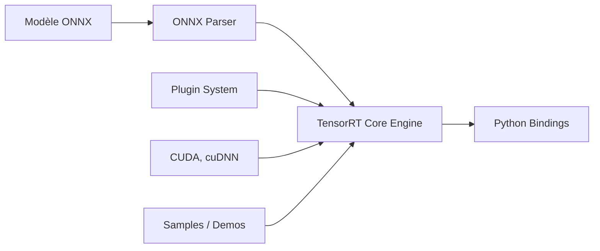

# NVIDIA/TensorRT

> Composants open source de TensorRT (plugins, parseur ONNX, exemples) pour accélérer l'inférence sur GPU NVIDIA.

## Le problème
Servir des modèles en production sur GPU exige une inférence optimisée, que les frameworks d'entraînement ne fournissent pas.

## Ce que ça fait vraiment
Le dépôt contient les sources des plugins, du parseur ONNX, des bindings Python, de démos et d'exemples. Il s'appuie sur le build GA de TensorRT (11.4) et sur CUDA, et se compile avec CMake, Docker et chaînes croisées (Jetson, DriveOS, QNX). TensorRT 11 retire les réseaux faiblement typés, la quantification implicite, IPluginV2 et l'outil TREX. Des skills d'agents de code sont fournis.

## Comment c'est branché


## Essayer
```bash
pip install tensorrt
git clone -b main https://github.com/nvidia/TensorRT TensorRT
cd TensorRT && git submodule update --init --recursive
./docker/build.sh --file docker/ubuntu-24.04.Dockerfile --tag tensorrt-ubuntu24.04-cuda13.4
```

## Coût et pièges
Gratuit, mais il faut un GPU NVIDIA, CUDA et le paquet TensorRT GA téléchargé à part. Passer de 10.x à 11.x demande une migration. 669 issues ouvertes.

## Ce que ce n'est pas
Pas le moteur complet : le cœur TensorRT n'est pas dans ce dépôt, seuls plugins, parseurs et exemples le sont. Pas utilisable sans matériel NVIDIA.

## Alternatives
Aucune alternative nommée dans le README.

## Pour toi
À adopter si tu déploies des modèles sur GPU NVIDIA : référence de l'inférence optimisée, Apache-2.0, portée par NVIDIA.

