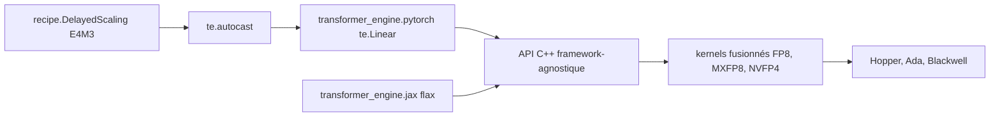

# NVIDIA/TransformerEngine

> Library accelerating Transformers on NVIDIA GPUs in FP8, MXFP8 and NVFP4 precisions.

## The problem
Training and serving a large Transformer saturates memory and compute.
Lowering precision by hand means managing the scaling factors yourself.

## What it actually does
Ready-made modules (`te.Linear`, Transformer layers) that internally maintain the FP8 scaling factors.
An autocast-style API: `with te.autocast(enabled=True, recipe=fp8_recipe)` around the forward pass.
A framework-independent C++ API, to give FP8 support to other libraries.
Existing integrations: Megatron-LM, NeMo, DeepSpeed, Hugging Face Accelerate, Lightning, GPT-NeoX.

## How it is wired


## Trying it
```bash
pip install --no-build-isolation transformer_engine[pytorch]
```
Or, recommended, via the NGC container:
```bash
docker run --gpus all -it --rm nvcr.io/nvidia/pytorch:26.01-py3
```

## Cost and gotchas
Blackwell, Hopper, Grace, Ada or Ampere GPU; FP8 requires compute capability 8.9 or higher.
Compiling FlashAttention-2 devours RAM: `MAX_JOBS=1` is the documented workaround.

## What it is not
Not a training framework: it provides building blocks, not a loop.
Not portable: Linux officially, WSL2 with limited support, nothing without an NVIDIA GPU.
Beware of the v1.7 break: the definition of the padding mask was inverted on the PyTorch side.

## Alternatives
No alternative named in the README.

## For you
The right lever if you train on Hopper or Blackwell; otherwise, go through NeMo or Megatron, which already integrate it.
