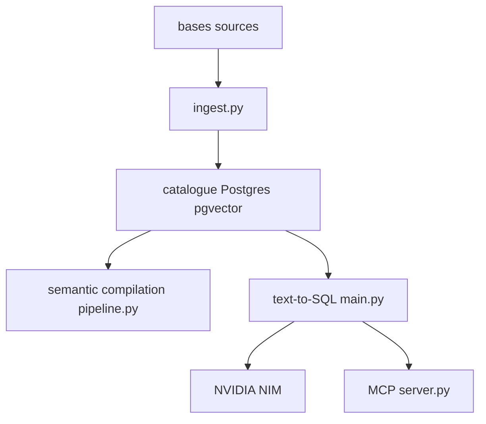

# NVIDIA/auto-ontology

> NVIDIA library that builds a semantic layer over enterprise databases and serves it to agents.

## The problem
An agent querying databases does not know where the data lives, what a metric means, or which one is certified: its figures may be wrong.

## What it actually does
Ingests metadata, generates an ontology and a catalog in Postgres/pgvector, tags PII. The chat translates a question into SQL, runs it on the sources (Databricks, Postgres, Snowflake, DuckDB) and returns the provenance. Exposed as a Next.js UI, an API with tokens, an MCP server and agent skills.

## How it is wired


## Trying it
```bash
git clone <repo-url> auto_ontology && cd auto_ontology
cp .env.example .env
docker compose up -d --build
```

## Cost and gotchas
An NVIDIA key (`nvapi-...`) is needed for LLM, embeddings and reranking. Without Vault, credentials of connections created in the UI are stored in clear text in Postgres. The FastAPI port must not be exposed. `AUTH_SECRET` and `APP_URL` are mandatory.

## What it is not
Not a simple document RAG tool. The project does not accept external contributions.

## Alternatives
No alternative named in the README.

## For you
Worth watching: very relevant for reliable agentic analytics, but young, tied to NVIDIA NIMs, and the clear-text storage by default calls for caution.
