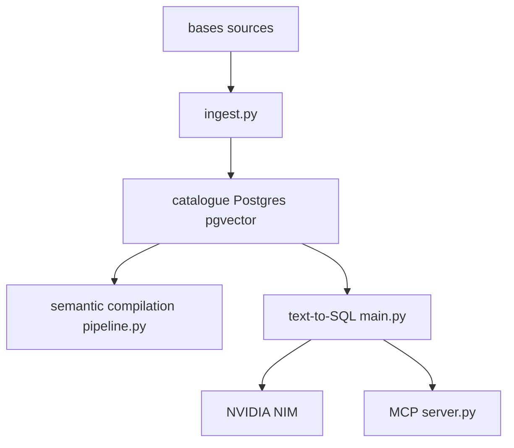

# NVIDIA/auto-ontology

> Bibliothèque NVIDIA qui construit une couche sémantique sur des bases d'entreprise et la sert aux agents.

## Le problème
Un agent qui interroge des bases ne sait pas où vivent les données, ce que signifie une métrique, ni laquelle est certifiée : ses chiffres peuvent être faux.

## Ce que ça fait vraiment
Ingère les métadonnées, génère une ontologie et un catalogue dans Postgres/pgvector, étiquette les PII. Le chat traduit une question en SQL, l'exécute sur les sources (Databricks, Postgres, Snowflake, DuckDB) et renvoie la provenance. Exposé en UI Next.js, API avec jetons, serveur MCP et skills d'agents.

## Comment c'est branché


## Essayer
```bash
git clone <repo-url> auto_ontology && cd auto_ontology
cp .env.example .env
docker compose up -d --build
```

## Coût et pièges
Clé NVIDIA (`nvapi-...`) pour LLM, embeddings et reranking. Sans Vault, les identifiants des connexions créées dans l'UI sont stockés en clair dans Postgres. Le port FastAPI ne doit pas être exposé. `AUTH_SECRET` et `APP_URL` obligatoires.

## Ce que ce n'est pas
Pas un simple outil de RAG documentaire. Le projet n'accepte pas de contributions externes.

## Alternatives
Aucune alternative nommée dans le README.

## Pour toi
À surveiller : très pertinent pour de l'analytique agentique fiable, mais jeune, lié aux NIM de NVIDIA, et le stockage en clair par défaut impose de la prudence.

