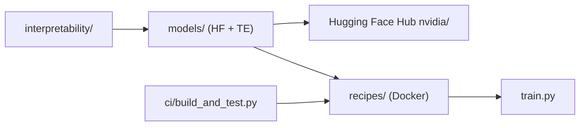

# NVIDIA/bionemo-framework

> Biological foundation model training models and recipes (ESM-2, Geneformer, AMPLIFY) with TransformerEngine.

## The problem
Moving a biological model prototype from one GPU to several nodes requires optimizations (FP8, FSDP) that are poorly documented.

## What it actually does
Three folders: `models/` (Hugging Face `PreTrainedModel` classes with TransformerEngine layers, checkpoints on the Hub), `recipes/` (self-contained Docker containers: PyTorch, Accelerate, Lightning, FP8, megatron-FSDP, context parallelism), `interpretability/` (sparse autoencoders). The recipes cannot be installed with pip. Tests come in three levels, L0 to L2.

## How it is wired


## Trying it
```bash
cd recipes/esm2_native_te
docker build -t esm2_recipe .
docker run --rm -it --gpus all esm2_recipe python train.py
```

## Cost and gotchas
NVIDIA GPU required (up to several nodes for the heavy tests). No license declared in the catalog: check before reuse. The recipes serve as a reference to adapt.

## What it is not
Not a complete "all-inclusive" training framework: the README says so. No data provided.

## Alternatives
None named in the README (compatible with Hugging Face Accelerate and PyTorch Lightning).

## For you
Worth watching if you do bio/pharma on GPU: the scale-out recipes are worth a look, but the missing license blocks firm adoption.
