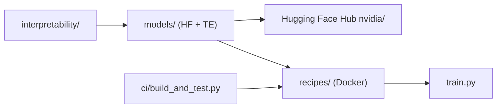

# NVIDIA/bionemo-framework

> Modèles et recettes d'entraînement de modèles de fondation biologiques (ESM-2, Geneformer, AMPLIFY) avec TransformerEngine.

## Le problème
Passer un prototype de modèle biologique d'un GPU à plusieurs nœuds demande des optimisations (FP8, FSDP) peu documentées.

## Ce que ça fait vraiment
Trois dossiers : `models/` (classes `PreTrainedModel` Hugging Face à couches TransformerEngine, checkpoints sur le Hub), `recipes/` (conteneurs Docker autonomes : PyTorch, Accelerate, Lightning, FP8, megatron-FSDP, parallélisme de contexte), `interpretability/` (autoencodeurs épars). Les recettes ne sont pas installables par pip. Tests en trois niveaux L0 à L2.

## Comment c'est branché


## Essayer
```bash
cd recipes/esm2_native_te
docker build -t esm2_recipe .
docker run --rm -it --gpus all esm2_recipe python train.py
```

## Coût et pièges
GPU NVIDIA requis (jusqu'à plusieurs nœuds pour les tests lourds). Pas de licence déclarée dans le catalogue : à vérifier avant réemploi. Les recettes servent de référence à adapter.

## Ce que ce n'est pas
Pas un framework d'entraînement complet « tout compris » : le README le dit. Pas de données fournies.

## Alternatives
Aucune nommée dans le README (compatibilité avec Hugging Face Accelerate et PyTorch Lightning).

## Pour toi
À surveiller si tu fais de la bio/pharma sur GPU : les recettes de scale-out valent le détour, mais la licence absente bloque une adoption ferme.

