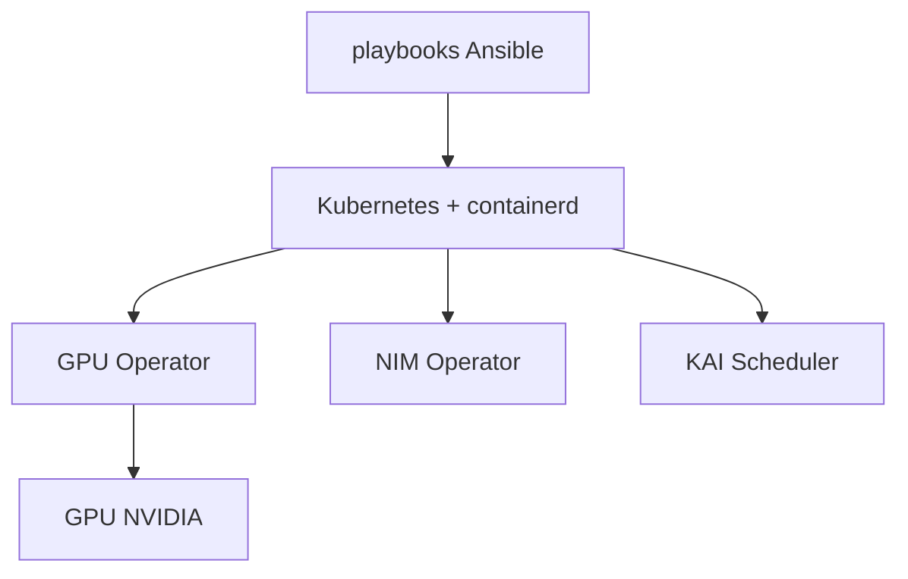

# NVIDIA/cloud-native-stack

> Reference architecture and Ansible playbooks to set up Kubernetes with the NVIDIA operators, intended for tests and PoCs.

## The problem
Assembling Kubernetes, containerd, drivers and GPU operators in mutually compatible versions is tedious.

## What it actually does
Publishes a matrix of versions tested together (Kubernetes, GPU Operator, NIM Operator, KAI Scheduler, driver...). Provides manual guides and Ansible playbooks. Handles a single node or a control plane with workers. The README states that the installed Kubernetes is basic, without high availability.

## How it is wired
Simplified diagram based on the sheet, no diagram provided.


## Trying it
```bash
git clone -b 26.6.0 https://github.com/NVIDIA/cloud-native-stack.git
cd cloud-native-stack/playbooks
bash setup.sh install
```

## Cost and gotchas
At least one NVIDIA GPU, Ubuntu, 40 GB of disk, Secure Boot disabled, a single network interface. SSH credentials in plain text in the `hosts` file.

## What it is not
Not a production installation: only the NVIDIA components are production-grade. No multiple control plane.

## Alternatives
Not documented in the README (MicroK8s is mentioned as an installation variant).

## For you
Worth watching: a good base for a GPU Kubernetes test bench or the version matrix, but not for production.
