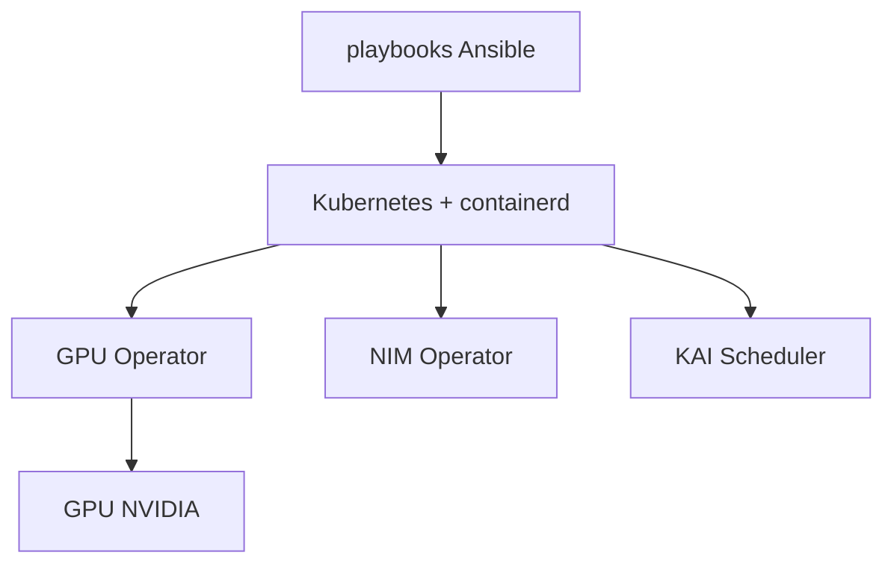

# NVIDIA/cloud-native-stack

> Architecture de référence et playbooks Ansible pour monter Kubernetes avec les opérateurs NVIDIA, destinée aux tests et PoC.

## Le problème
Assembler Kubernetes, containerd, pilotes et opérateurs GPU en versions compatibles entre elles est fastidieux.

## Ce que ça fait vraiment
Publie une matrice de versions testées ensemble (Kubernetes, GPU Operator, NIM Operator, KAI Scheduler, driver…). Fournit des guides manuels et des playbooks Ansible. Gère un nœud unique ou un plan de contrôle avec des workers. Le README précise que le Kubernetes installé est basique, sans haute disponibilité.

## Comment c'est branché
Schéma simplifié d'après la fiche, sans diagramme fourni.


## Essayer
```bash
git clone -b 26.6.0 https://github.com/NVIDIA/cloud-native-stack.git
cd cloud-native-stack/playbooks
bash setup.sh install
```

## Coût et pièges
Au moins un GPU NVIDIA, Ubuntu, 40 Go de disque, Secure Boot désactivé, une seule interface réseau. Identifiants SSH en clair dans le fichier `hosts`.

## Ce que ce n'est pas
Pas une installation de production : seuls les composants NVIDIA le sont. Pas de plan de contrôle multiple.

## Alternatives
Non documenté dans le README (MicroK8s est cité comme variante d'installation).

## Pour toi
À surveiller : bonne base pour un banc d'essai GPU Kubernetes ou la matrice de versions, mais pas pour la production.

