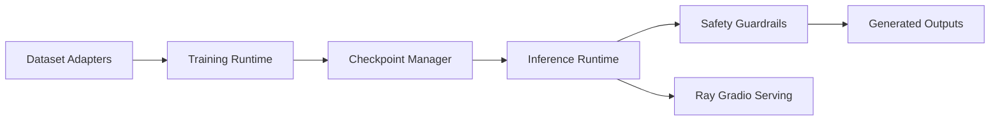

# NVIDIA/cosmos-framework

> Framework for training and serving Cosmos 3 world models, for physical AI teams with GPUs.

## The problem
Training and serving omnimodal models (text, image, video, audio, actions) requires assembling parallelism, checkpoints and inference backends by hand.

## What it actually does
A `cosmos_framework/` package covers distributed training (FSDP, TP, CP, PP), DCP checkpoints with safetensors import/export, and inference through Diffusers, Transformers or vLLM. It serves in batch or online (Ray + Gradio) and includes a policy server. Agent skills (`.agents/skills/`) help with installation and troubleshooting.

## How it is wired


## Trying it
```bash
sudo apt-get install -y --no-install-recommends curl ffmpeg git-lfs libx11-dev tree wget
uv sync --all-extras --group=cu130-train
source .venv/bin/activate && export LD_LIBRARY_PATH=
bash examples/launch_sft_vision_nano.sh
python -m cosmos_framework.scripts.inference \
    --parallelism-preset=latency \
    -i "inputs/omni/t2v.json" \
    -o outputs/omni_nano \
    --checkpoint-path Cosmos3-Nano \
    --seed=0
```

## Cost and gotchas
The provided recipes use 8 GPUs (tested on 8× H100 80 GB). CUDA 12.8 or 13.0 required, and checkpoints to download. The licence is not recognized by GitHub: read it before any commercial use.

## What it is not
Not a turnkey demo: to try Cosmos 3, the README points to the NVIDIA/cosmos repository. Not intended for a laptop without a GPU.

## Alternatives
The README names no alternative; it points to nvidia/cosmos for a guided start.

## For you
Watch: useful if you fine-tune world models on a GPU cluster, but the licence must be checked and the required hardware is heavy.
