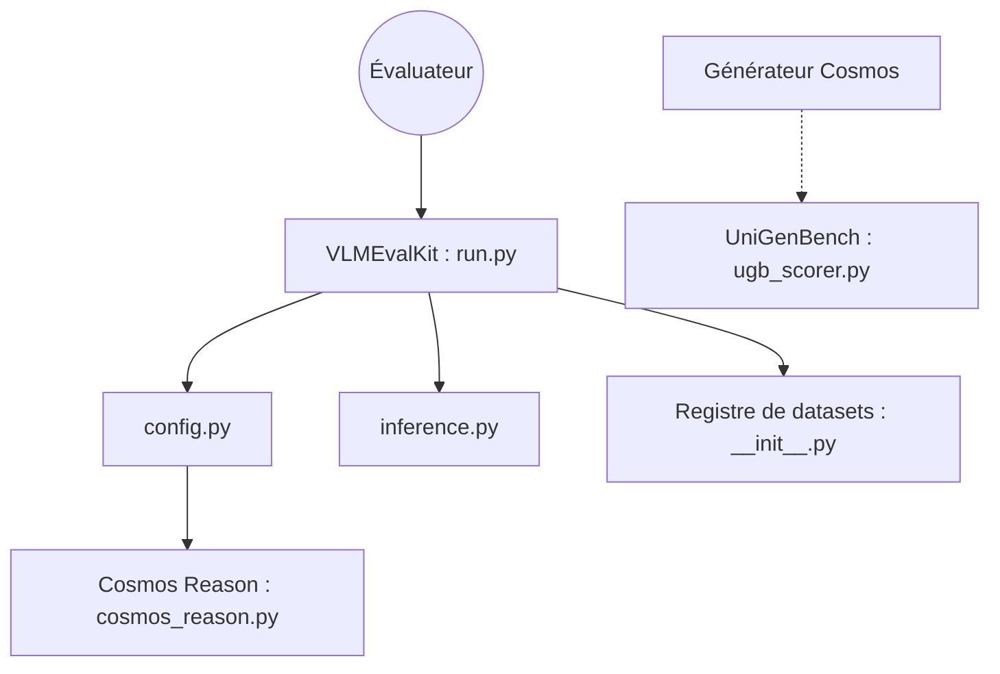

# NVIDIA/cosmos

> Home repository of the Cosmos 3 world models for physical AI: generation, reasoning, robotics and autonomous driving.

## The problem
Training robots and autonomous vehicles requires realistic synthetic data and world simulators.

## What it actually does
Three base models: Super (64 billion parameters), Nano (16 billion) and Edge (4 billion), with a "reasoner" tower (text) and a "generator" tower (vision, audio, action). The repository offers a getting-started guide, a cookbook and evaluation suites. The code supplied for analysis is mostly the VLMEvalKit and UniGenBench evaluation tooling.

## How it is wired


## Trying it
```bash
uv venv --python 3.13 --seed --managed-python && source .venv/bin/activate
uv pip install --torch-backend=auto \
  "diffusers @ git+https://github.com/huggingface/diffusers.git" \
  accelerate av cosmos_guardrail huggingface_hub imageio imageio-ffmpeg \
  torch torchvision transformers
uvx hf@latest auth login
```

## Cost and gotchas
A GPU is required (the first run downloads a 16-billion-parameter checkpoint) and access to the Guardrail repository must be requested on Hugging Face. The diffusion steps are heavy.

## What it is not
Not a code repository for the models: it is the entry point. It can produce artifacts (temporal inconsistencies): no critical use without validation. License not identified.

## Alternatives
No alternative cited in the README.

## For you
Worth watching: a reference for physical AI and its evaluations, but it requires a GPU and a license to check before any serious use.
