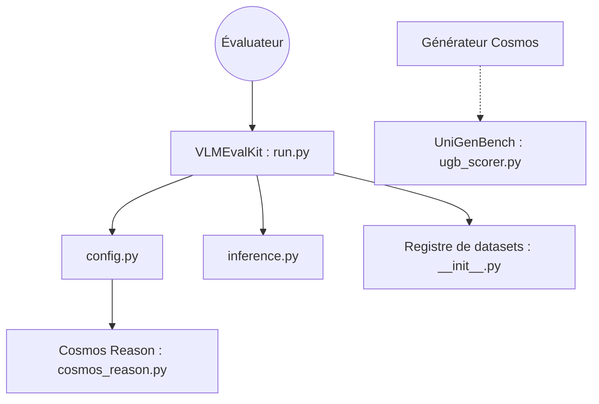

# NVIDIA/cosmos

> Dépôt d'accueil des modèles de monde Cosmos 3 pour l'IA physique : génération, raisonnement, robotique et conduite autonome.

## Le problème
Entraîner des robots et véhicules autonomes demande des données synthétiques réalistes et des simulateurs de monde.

## Ce que ça fait vraiment
Trois modèles de base : Super (64 milliards de paramètres), Nano (16 milliards) et Edge (4 milliards), avec un tour « raisonneur » (texte) et un tour « générateur » (vision, audio, action). Le dépôt offre un guide de démarrage, un livre de recettes et des suites d'évaluation. Le code fourni à l'analyse est surtout l'outillage d'évaluation VLMEvalKit et UniGenBench.

## Comment c'est branché


## Essayer
```bash
uv venv --python 3.13 --seed --managed-python && source .venv/bin/activate
uv pip install --torch-backend=auto \
  "diffusers @ git+https://github.com/huggingface/diffusers.git" \
  accelerate av cosmos_guardrail huggingface_hub imageio imageio-ffmpeg \
  torch torchvision transformers
uvx hf@latest auth login
```

## Coût et pièges
GPU exigé (le premier lancement télécharge un point de contrôle de 16 milliards de paramètres) et accès au dépôt Guardrail à demander sur Hugging Face. Les étapes de diffusion sont lourdes.

## Ce que ce n'est pas
Pas un dépôt de code des modèles : c'est le point d'entrée. Peut produire des artefacts (incohérences temporelles) : pas de usage critique sans validation. Licence non identifiée.

## Alternatives
Aucune alternative citée dans le README.

## Pour toi
À surveiller : référence pour l'IA physique et ses évaluations, mais exige du GPU et une licence à vérifier avant tout usage sérieux.

