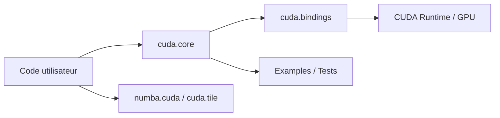

# NVIDIA/cuda-python

> Python entry point to the CUDA platform: low-level bindings, high-level API, kernel DSL.

## The problem
Calling CUDA from Python often forces in-house bindings or abstractions that are incompatible across libraries.

## What it actually does
The repo is a metapackage whose subpackages are each versioned separately. `cuda.bindings` covers the host APIs (Driver, Runtime, NVRTC, nvJitLink, NVVM, cuFile, NVML). `cuda.core` offers "Pythonic" access to the runtime and the JIT. It also lists cuda.compute, numba.cuda, cuda.tile, nvmath-python and profiling tools.

## How it is wired

## Trying it
The README gives no installation command; it points to the `cuda.bindings` documentation. The PyPI package is called `cuda-python`, but that name does not appear as a command in the README.

## Cost and gotchas
Free, but an NVIDIA GPU and a CUDA driver are required. The repo is being restructured ("overhaul").

## What it is not
Not a deep learning framework: it is the access layer to CUDA. Some listed components (numba-cuda-mlir, cuda.tile) are described as new.

## Alternatives
No alternative named in the README.

## For you
Adopt if you write GPU kernels or CUDA tools in Python: it is NVIDIA's official route, actively pushed.
