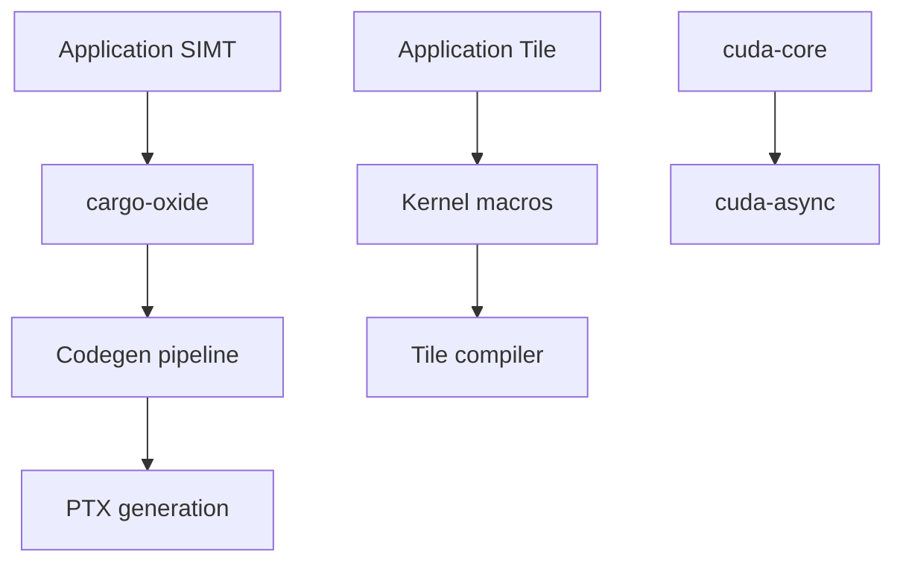

# NVIDIA/cuda-rust

> NVIDIA's CUDA platform for Rust: GPU kernels written in Rust, in thread-by-thread or tile style.

## The problem
CUDA kernels are written in C++, without Rust's ownership and borrowing guarantees.

## What it actually does
The repository brings together two models: cuda-oxide (SIMT, Rust to PTX) and cutile-rs (tiles, just-in-time compilation, Rust to Tile IR then cubin). A common runtime provides driver bindings, contexts, streams, buffers, events and deferred asynchronous operations, with CUDA graphs. Its README is identical to that of NVlabs/cuda-oxide, with the same catalog figures: probably the same project under a second name.

## How it is wired


## Trying it
```bash
# Aucune commande complète dans le README : il renvoie aux livres cuda-oxide et cutile-rs.
```

## Cost and gotchas
Free, with an NVIDIA GPU. The README announces an early research project, with likely API breakage. Cutile-rs requires Rust 1.89 or later; cuda-oxide a pinned version managed by `cargo oxide`.

## What it is not
Not a turnkey compute library. The two models are chosen kernel by kernel and can coexist.

## Alternatives
No alternative named in the README.

## For you
Watch: apparent duplicate of NVlabs/cuda-oxide, to be followed only once to understand how CUDA is evolving on the Rust side.
