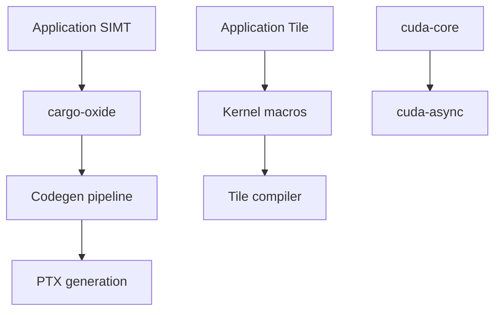

# NVIDIA/cuda-rust

> Plateforme CUDA pour Rust de NVIDIA : noyaux GPU écrits en Rust, au style fil par fil ou par tuiles.

## Le problème
Les noyaux CUDA s'écrivent en C++, sans les garanties de possession et d'emprunt de Rust.

## Ce que ça fait vraiment
Le dépôt réunit deux modèles : cuda-oxide (SIMT, de Rust vers PTX) et cutile-rs (tuiles, compilation à la volée, Rust vers Tile IR puis cubin). Un runtime commun apporte liaisons du pilote, contextes, flux, tampons, événements et opérations asynchrones en différé, avec graphes CUDA. Son README est identique à celui de NVlabs/cuda-oxide, aux mêmes chiffres du catalogue : probablement le même projet sous un second nom.

## Comment c'est branché


## Essayer
```bash
# Aucune commande complète dans le README : il renvoie aux livres cuda-oxide et cutile-rs.
```

## Coût et pièges
Gratuit, avec un GPU NVIDIA. Le README annonce un projet de recherche précoce, avec ruptures d'API probables. Cutile-rs demande Rust 1.89 ou plus ; cuda-oxide une version épinglée gérée par `cargo oxide`.

## Ce que ce n'est pas
Ce n'est pas une bibliothèque de calcul clé en main. Les deux modèles se choisissent noyau par noyau et peuvent coexister.

## Alternatives
Aucune alternative nommée dans le README.

## Pour toi
À surveiller : doublon apparent de NVlabs/cuda-oxide, à suivre une seule fois pour comprendre l'évolution de CUDA côté Rust.

