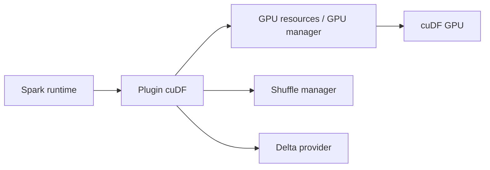

# NVIDIA/cudf-spark

> NVIDIA Spark plugin that accelerates SQL and DataFrames on GPU via cuDF (formerly the RAPIDS Accelerator).

## The problem
Large Spark jobs are slow and expensive on CPU; the goal is to speed them up without changing the code.

## What it actually does
Spark plugin that runs SQL operators on GPU, aiming for results identical to Spark. According to the code: GPU resource management, an optimized shuffle manager, Delta Lake support (DML, merge, optimize, deletion vectors, change feed). Zero-copy transfer APIs to other GPU applications (work in progress with XGBoost). Qualification and profiling tools live in another repository. Formerly `spark-rapids`.

## How it is wired


## Trying it
```xml
<dependency>
    <groupId>com.nvidia</groupId>
    <artifactId>rapids-4-spark_2.12</artifactId>
    <version>26.12.0-SNAPSHOT</version>
    <scope>provided</scope>
</dependency>
```

## Cost and gotchas
An NVIDIA GPU is required. Configuration, tuning and operator compatibility are to be read in the documentation. 2,113 open issues. License not identified by GitHub.

## What it is not
Not usable without a GPU. Artifact names still carry "rapids-4-spark".

## Alternatives
- NVIDIA/cudf-spark-tools: qualification/profiling tools (cited).
- XGBoost: integration in progress (cited).

## For you
Worth watching if you run Spark on GPUs; otherwise CPU acceleration such as Comet is simpler to test.
