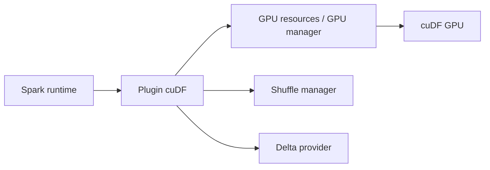

# NVIDIA/cudf-spark

> Plugin Spark de NVIDIA qui accélère le SQL et les DataFrames sur GPU via cuDF (ex RAPIDS Accelerator).

## Le problème
Les gros jobs Spark sont longs et coûteux sur CPU ; on veut les accélérer sans changer le code.

## Ce que ça fait vraiment
Plugin Spark qui exécute les opérateurs SQL sur GPU avec l'objectif de résultats identiques à Spark. D'après le code : gestion des ressources GPU, shuffle manager optimisé, support Delta Lake (DML, merge, optimize, deletion vectors, change feed). APIs de transfert zéro copie vers d'autres applications GPU (travail en cours avec XGBoost). Outils de qualification et profilage dans un autre dépôt. Anciennement `spark-rapids`.

## Comment c'est branché


## Essayer
```xml
<dependency>
    <groupId>com.nvidia</groupId>
    <artifactId>rapids-4-spark_2.12</artifactId>
    <version>26.12.0-SNAPSHOT</version>
    <scope>provided</scope>
</dependency>
```

## Coût et pièges
GPU NVIDIA indispensable. Configuration, tuning et compatibilité des opérateurs à lire dans la documentation. 2 113 issues ouvertes. Licence non identifiée par GitHub.

## Ce que ce n'est pas
Pas utilisable sans GPU. Les noms d'artefacts gardent encore « rapids-4-spark ».

## Alternatives
- NVIDIA/cudf-spark-tools : outils de qualification/profilage (cités).
- XGBoost : intégration en cours (citée).

## Pour toi
À surveiller si tu opères Spark sur des GPU ; sinon l'accélération CPU type Comet est plus simple à tester.

