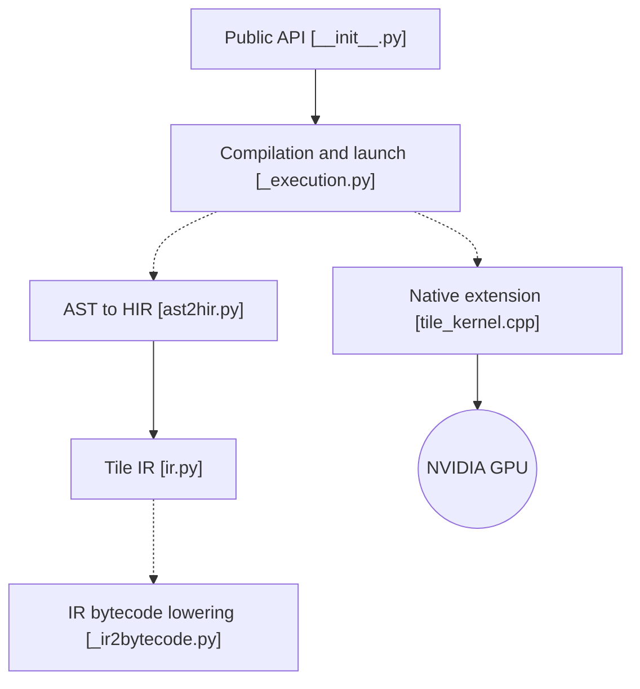

# NVIDIA/cutile-python

> Python language for writing NVIDIA GPU kernels by tiles, compiled to Tile IR.

## The problem
Writing CUDA kernels by hand is slow and tied to the hardware. Kernel authors want a more abstract tile-based model.

## What it actually does
You write a Python kernel decorated with `@ct.kernel` using `ct.load`, `ct.store`, `ct.launch`. The code is transformed AST, HIR, IR, bytecode, then launched through a native C++ extension. There is a compilation cache, an autotuner, a JAX integration and experimental packages.

## How it is wired


## Trying it
```bash
pip install cuda-tile[tileiras]
pip install cupy-cuda13x
pytest test/test_copy.py
```

## Cost and gotchas
NVIDIA driver r580+, CUDA Toolkit 13.1+ otherwise the `tileiras` compiler. The 13.2 compiler only supports Blackwell and Ampere/Ada; Hopper will come later.

## What it is not
Not a deep learning framework: it is a kernel language. Locked to NVIDIA. Experimental APIs may change. License: the catalog does not identify it, whereas the README states Apache 2.0, to be confirmed.

## Alternatives
Samples and TileGym (cited by the README as complementary examples).

## For you
Keep an eye on it: relevant for anyone optimizing GPU kernels on recent hardware; too low-level and hardware-dependent for everyday use.
