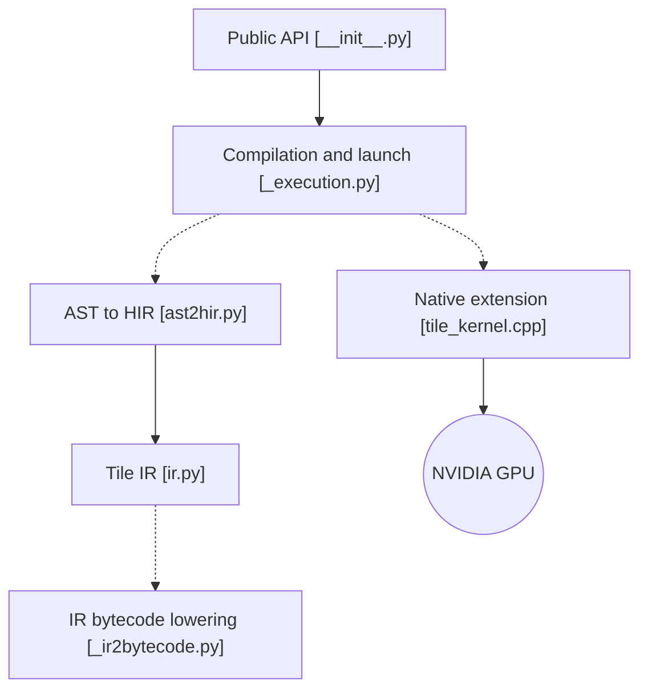

# NVIDIA/cutile-python

> Langage Python pour écrire des noyaux GPU NVIDIA par tuiles, compilés vers Tile IR.

## Le problème
Écrire des noyaux CUDA à la main est long et lié au matériel. L'auteur de noyaux veut un modèle par tuiles plus abstrait.

## Ce que ça fait vraiment
Tu écris un noyau Python décoré par `@ct.kernel` avec `ct.load`, `ct.store`, `ct.launch`. Le code est transformé AST, HIR, IR, bytecode, puis lancé via une extension native C++. Il y a un cache de compilation, un autotuner, une intégration JAX et des paquets expérimentaux.

## Comment c'est branché


## Essayer
```bash
pip install cuda-tile[tileiras]
pip install cupy-cuda13x
pytest test/test_copy.py
```

## Coût et pièges
Pilote NVIDIA r580+, CUDA Toolkit 13.1+ sinon compilateur `tileiras`. Le compilateur 13.2 ne gère que Blackwell et Ampere/Ada ; Hopper viendra plus tard.

## Ce que ce n'est pas
Pas un framework de deep learning : c'est un langage de noyaux. Verrouillé sur NVIDIA. Les API expérimentales peuvent changer. Licence : le catalogue ne l'identifie pas, alors que le README annonce Apache 2.0, à confirmer.

## Alternatives
Samples et TileGym (cités par le README comme exemples complémentaires).

## Pour toi
Surveiller : pertinent pour qui optimise des noyaux GPU sur matériel récent ; trop bas niveau et matériel-dépendant pour un usage courant.

