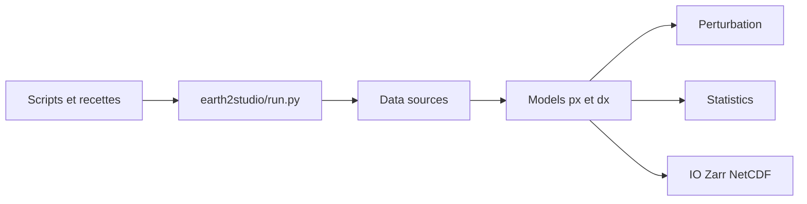

# NVIDIA/earth2studio

> Python inference toolkit for AI weather and climate models, with a unified API.

## The problem
Each AI weather model has its own inputs, data and outputs; comparing or chaining them costs glue code.

## What it actually does
Provides prognostic models (FourCastNet3, AIFS, GraphCast) and diagnostic ones, data sources (GFS, IFS, ERA5), perturbations for ensembles, statistics (RMSE, CRPS) and Zarr or NetCDF outputs. A `run` module chains source, model and output. Agent skills install it and guide a first forecast.

## How it is wired


## Trying it
```bash
npx skills add NVIDIA/skills --skill earth2studio-install
```
```python
from earth2studio.models.px import FCN3
from earth2studio.data import GFS
from earth2studio.io import ZarrBackend
from earth2studio.run import deterministic as run
model = FCN3.load_model(FCN3.load_default_package())
run(["2025-01-01T00:00:00"], 10, model, GFS(), ZarrBackend("outputs/fcn3_forecast.zarr"))
```

## Cost and gotchas
Data is read from remote providers; some models require their own installation. Model and dataset licenses belong to their providers: check each usage right. GPU requirements are not quantified in the README.

## What it is not
It is not a model in itself nor a forecasting service: it is an assembly layer.

## Alternatives
No alternative named; training is done in PhysicsNeMo, cited by the README.

## For you
Keep an eye on it: very useful if you do AI weather or climate work, otherwise too niche a domain; check each model's license.
