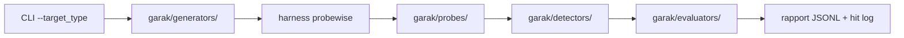

# NVIDIA/garak

> LLM vulnerability scanner: probes hallucination, leakage, injection, jailbreak, toxicity.

## The problem
Before putting an LLM into production you don't know which prompts it gives in to, and manual testing covers nothing reproducibly.

## What it actually does
Runs families of probes (`probes`) against a model and evaluates each response with detectors.
Provided probes: dan, encoding, gcg, glitch, leakreplay, malwaregen, packagehallucination, promptinject, snowball, xss, among others.
Generators for local or API Hugging Face, OpenAI, Replicate, Cohere, Groq, ggml, REST, NIM, AWS Bedrock.
Produces `garak.log`, a JSONL report per run and a hit log of successful attacks.

## How it is wired


## Trying it
```bash
python -m pip install -U garak
garak --list_probes
export OPENAI_API_KEY="sk-123XXXXXXXXXXXX"
python3 -m garak --target_type openai --target_name gpt-5-nano --spec probes.encoding
```

## Cost and gotchas
The tool is free but every run consumes the target model: ten generations per prompt by default, the API bill climbs quickly. Some generators require a key (OPENAI, HF_INFERENCE_TOKEN, COHERE, GROQ, NIM, BEDROCK). Python 3.11 to 3.13.

## What it is not
Not a production guardrail: it tests, it blocks nothing. Not a security guarantee: a FAIL signals a weakness, the absence of FAIL proves nothing. Large artifacts (models, corpora) live outside the repository and are downloaded on use.

## Alternatives
The README only cites PromptInject, RealToxicityPrompts and Language Model Risk Cards — works it implements, not competitors.

## For you
Install: it is the most fully equipped LLM red-teaming tool, with a plugin model that is simple to extend.
