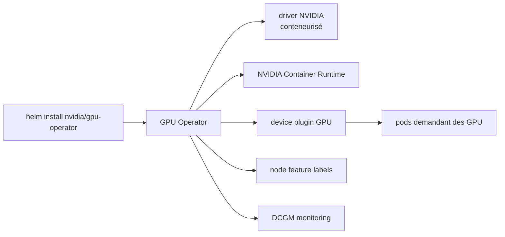

# NVIDIA/gpu-operator

> Kubernetes operator that installs and manages the whole NVIDIA software stack on GPU nodes.

## The problem
Exposing a GPU in Kubernetes requires drivers, a container runtime, a device plugin, labels and monitoring:
many components to configure, easy to break.
Maintaining a special OS image for GPU nodes does not scale.

## What it actually does
Automates the management of all the components needed to provision a GPU: NVIDIA drivers
(to enable CUDA), the Kubernetes device plugin, the NVIDIA Container Runtime, automatic node
labeling, and DCGM-based monitoring.
Everything runs in containers, drivers included, so a component is replaced by stopping a container.
Lets you manage GPU nodes like CPU nodes, with a standard OS image.

## How it is wired


## Trying it
```bash
helm repo add nvidia https://helm.ngc.nvidia.com/nvidia && helm repo update
helm install --wait --generate-name -n gpu-operator --create-namespace nvidia/gpu-operator
```

## Cost and gotchas
Free. The cluster must meet prerequisites and appear on the platform support page,
both of which are outside the README. OpenShift follows a separate procedure, documented elsewhere.
The README says nothing about the driver update cycle, which is nonetheless the sensitive point.

## What it is not
Not a scheduler or a quota manager: it makes GPUs available, it does not share them.
Not useful outside Kubernetes. Not independent of NVIDIA hardware.

## Alternatives
None named in the README.

## For you
The must-have if you build a Kubernetes cluster with GPUs: pair it with Kueue for quotas.
