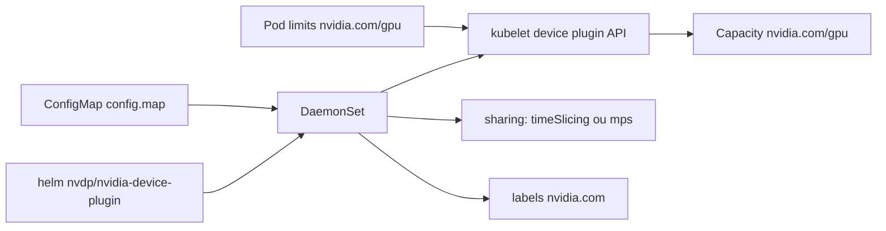

# NVIDIA/k8s-device-plugin

> DaemonSet that exposes the NVIDIA GPUs of a Kubernetes cluster as schedulable resources.

## The problem
Without it, Kubernetes ignores a node's GPUs: impossible to request one in a pod.
And nothing monitors their health.

## What it actually does
Publishes the number of GPUs per node and lets you request them via the `nvidia.com/gpu` resource.
Tracks GPU health and, since v0.15.0, carries the implementation of the GPU Feature Discovery labels.
Handles MIG via `MIG_STRATEGY` (`none`, `single`, `mixed`) and several device-passing strategies.
Allows oversubscribing a GPU through CUDA time-slicing or MPS, mutually exclusive.

## How it is wired


## Trying it
```shell
helm repo add nvdp https://nvidia.github.io/k8s-device-plugin
helm repo update
helm upgrade -i nvdp nvdp/nvidia-device-plugin \
  --namespace nvidia-device-plugin \
  --create-namespace \
  --version 0.17.1
```

## Cost and gotchas
NVIDIA drivers ~= 384.81, `nvidia-container-toolkit` >= 1.7.0 and a configured runtime, on every GPU node.
Without an explicit GPU request, the plugin exposes all of the machine's GPUs inside the container.

## What it is not
Not an intelligent scheduler: ten replicas of a GPU are distributed indiscriminately.
Not isolated sharing: with time-slicing, a workload that crashes takes all of them down.
MPS support has remained experimental since v0.15.0 and excludes MIG devices.

## Alternatives
No alternative named in the README; forks are not supported.

## For you
The mandatory step to run training on a cluster; read the sharing section first.
