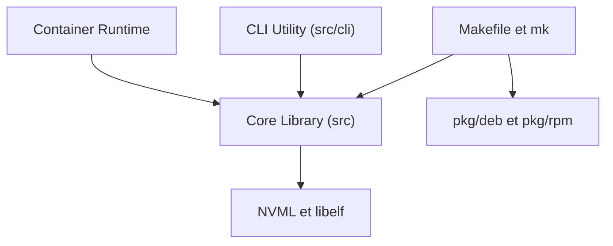

# NVIDIA/libnvidia-container

> C library and CLI that expose NVIDIA GPUs inside Linux containers, independently of the runtime.

## The problem
A container does not see the host's GPUs, drivers or CUDA libraries without specific configuration.

## What it actually does
Provides a library and the `nvidia-container-cli` tool that mount GPU devices and driver libraries into a container's namespaces. It relies on kernel primitives and stays independent of the container runtime. The `libnvidia-container1` and `libnvidia-container-tools` packages are provided for deb and rpm.

## How it is wired


## Trying it
```bash
DESTDIR=/path/to/root make install prefix=/usr
nvidia-container-cli --load-kmods configure --ldconfig=@/sbin/ldconfig.real --no-cgroups --utility --device 0 $(pwd)
nvidia-smi -L
```

## Cost and gotchas
Free, but you need a Linux machine with a GPU and an NVIDIA driver. The command-line example mounts a rootfs by hand with root privileges.

## What it is not
Not a container runtime: you use it through the nvidia-container-runtime project. Usually you install the package rather than calling it directly.

## Alternatives
No alternative named in the README.

## For you
Watch: it is the underlying building block for GPU in Docker, worth knowing for debugging, rarely handled directly.
