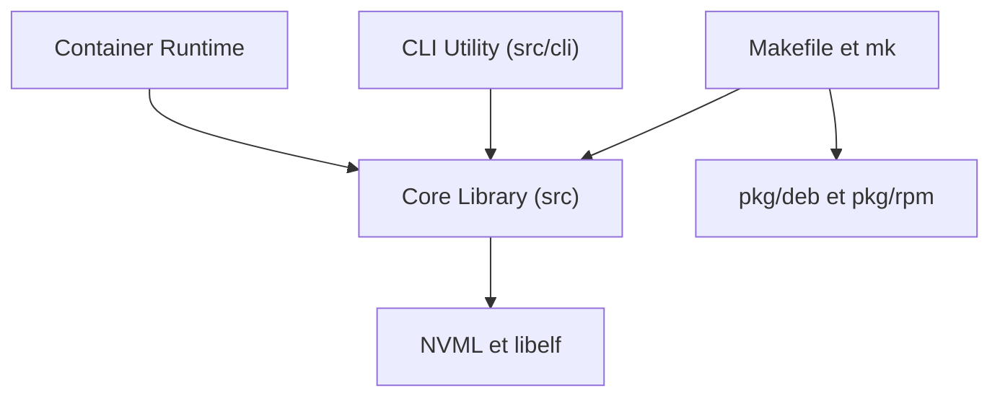

# NVIDIA/libnvidia-container

> Bibliothèque et CLI C qui exposent les GPU NVIDIA dans des conteneurs Linux, indépendamment du runtime.

## Le problème
Un conteneur ne voit pas les GPU, les pilotes ni les bibliothèques CUDA de l'hôte sans configuration spécifique.

## Ce que ça fait vraiment
Fournit une bibliothèque et l'outil `nvidia-container-cli` qui montent les périphériques GPU et les bibliothèques de pilote dans les espaces de noms d'un conteneur. Elle s'appuie sur les primitives du noyau et reste indépendante du runtime de conteneurs. Les paquets `libnvidia-container1` et `libnvidia-container-tools` sont fournis pour deb et rpm.

## Comment c'est branché


## Essayer
```bash
DESTDIR=/path/to/root make install prefix=/usr
nvidia-container-cli --load-kmods configure --ldconfig=@/sbin/ldconfig.real --no-cgroups --utility --device 0 $(pwd)
nvidia-smi -L
```

## Coût et pièges
Gratuit, mais il faut une machine Linux avec GPU et pilote NVIDIA. L'exemple en ligne de commande monte un rootfs à la main avec des droits root.

## Ce que ce n'est pas
Pas un runtime de conteneurs : on l'utilise via le projet nvidia-container-runtime. En général, on installe le paquet plutôt que de l'appeler directement.

## Alternatives
Aucune alternative nommée dans le README.

## Pour toi
À surveiller : c'est la brique sous-jacente du GPU dans Docker, à connaître pour déboguer, rarement à manipuler directement.

