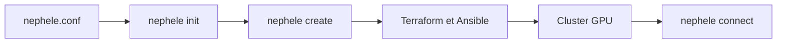

# NVIDIA/nephele

> Command-line tool that creates a GPU cluster in the cloud with Terraform and Ansible.

## The problem
Setting up a GPU compute cluster in the cloud requires chaining infrastructure, configuration and containers. Done by hand, it is slow and hard to reproduce.

## What it actually does
The `nephele` script reads a `nephele.conf` file, creates the cluster, lets you connect to the head node or a compute node, then destroys it. The prerequisites are enroot, Terraform and Ansible, plus the Azure CLI for Azure.

## How it is wired
Simplified diagram based on the fiche, no diagram provided.



## Trying it
```bash
git clone --recursive https://github.com/NVIDIA/nephele.git
export CONTAINERIZED_BUILD=1
./nephele init
./nephele create
./nephele connect
./nephele destroy
```

## Cost and gotchas
The cluster machines are billed by the cloud provider, with an account (Azure in the example). Last push in April 2023.

## What it is not
Not a training orchestrator: it provides the cluster, not the jobs. The README does not document supported providers beyond Azure.

## Alternatives
No alternative named in the README.

## For you
Worth watching: the idea of a disposable GPU cluster is useful in MLOps, but the repo has been inactive since 2023 and a maintained tool is preferable.
