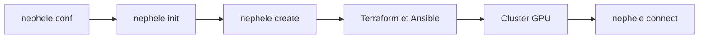

# NVIDIA/nephele

> Outil en ligne de commande qui crée un cluster GPU dans le cloud avec Terraform et Ansible.

## Le problème
Monter un cluster de calcul GPU dans le cloud demande d'enchaîner infrastructure, configuration et conteneurs. À la main, c'est long et peu reproductible.

## Ce que ça fait vraiment
Le script `nephele` lit un fichier `nephele.conf`, crée le cluster, permet de se connecter au nœud de tête ou à un nœud de calcul, puis le détruit. Les prérequis sont enroot, Terraform et Ansible, plus l'Azure CLI pour Azure.

## Comment c'est branché
Schéma simplifié d'après la fiche, sans diagramme fourni.



## Essayer
```bash
git clone --recursive https://github.com/NVIDIA/nephele.git
export CONTAINERIZED_BUILD=1
./nephele init
./nephele create
./nephele connect
./nephele destroy
```

## Coût et pièges
Les machines du cluster sont facturées par le fournisseur cloud, avec un compte (Azure dans l'exemple). Dernier push en avril 2023.

## Ce que ce n'est pas
Pas un orchestrateur d'entraînement : il fournit le cluster, pas les jobs. Le README ne documente pas les fournisseurs pris en charge au-delà d'Azure.

## Alternatives
Aucune alternative nommée dans le README.

## Pour toi
À surveiller : l'idée de cluster GPU jetable est utile en MLOps, mais le dépôt est inactif depuis 2023 et mieux vaut un outil maintenu.

