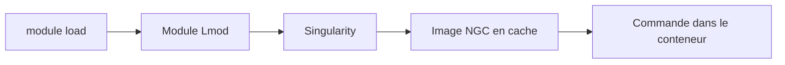

# NVIDIA/ngc-container-environment-modules

> Lmod environment modules that run NGC containers like local commands, for HPC clusters.

## The problem
On an HPC cluster, users want NGC containers without changing their `module load` habits.

## What it actually does
Lmod modules wrap NGC images through Singularity. After `module load gromacs`, the host's `gmx` command runs inside the container. The image is pulled and cached on first use. Examples cover GROMACS, PyTorch, RAPIDS in Jupyter and LAMMPS with MPI.

## How it is wired
Simplified diagram based on the fiche, no diagram provided.



## Trying it
```bash
git clone https://github.com/NVIDIA/ngc-container-environment-modules
module use $(pwd)/ngc-container-environment-modules
module load gromacs
gmx
```

## Cost and gotchas
Lmod and Singularity 3.4.1 or later required, with GPUs for the examples. The README warns that the modules must be adapted to the site. Last push in November 2021.

## What it is not
Not a container manager: it relies on Singularity. It is a reference to modify, not a ready-made installation.

## Alternatives
No alternative named in the README.

## For you
Worth watching: the idea is useful if you work on an HPC cluster with Lmod, but the repository has not moved since 2021.
