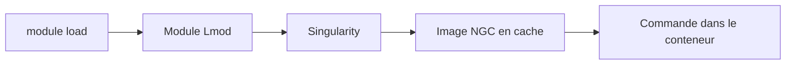

# NVIDIA/ngc-container-environment-modules

> Modules d'environnement Lmod qui exécutent les conteneurs NGC comme des commandes locales, pour clusters HPC.

## Le problème
Sur un cluster HPC, les utilisateurs veulent les conteneurs NGC sans changer leurs habitudes de `module load`.

## Ce que ça fait vraiment
Des modules Lmod enveloppent les images NGC via Singularity. Après `module load gromacs`, la commande `gmx` de l'hôte s'exécute dans le conteneur. L'image est tirée et mise en cache au premier usage. Des exemples couvrent GROMACS, PyTorch, RAPIDS dans Jupyter et LAMMPS en MPI.

## Comment c'est branché
Schéma simplifié d'après la fiche, sans diagramme fourni.



## Essayer
```bash
git clone https://github.com/NVIDIA/ngc-container-environment-modules
module use $(pwd)/ngc-container-environment-modules
module load gromacs
gmx
```

## Coût et pièges
Lmod et Singularity 3.4.1 ou plus requis, avec des GPU pour les exemples. Le README prévient qu'il faut adapter les modules au site. Dernier push en novembre 2021.

## Ce que ce n'est pas
Pas un gestionnaire de conteneurs : il s'appuie sur Singularity. C'est une référence à modifier, pas une installation prête.

## Alternatives
Aucune alternative nommée dans le README.

## Pour toi
À surveiller : l'idée est utile si tu travailles sur un cluster HPC avec Lmod, mais le dépôt n'a pas bougé depuis 2021.

