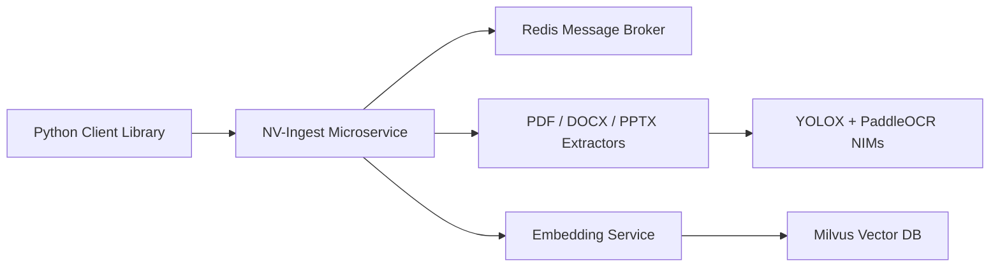

# NVIDIA/nv-ingest

> NeMo Retriever library for extracting text, tables and charts from documents for RAG.

## The problem
PDFs contain tables and charts that classic text extractors miss.

## What it actually does
Lazy chain: `create_ingestor`, `.extract()`, `.embed()`, `.vdb_upload()`, `.ingest()` which returns a DataFrame. Classifies page elements, applies OCR, computes embeddings and stores them in LanceDB (Milvus in the old diagram). Small volume: local Hugging Face models or NIMs on build.nvidia.com; production: Kubernetes and Helm. The README announces the removal of older APIs.

## How it is wired


## Trying it
```python
from nemo_retriever import create_ingestor
ingestor = create_ingestor(run_mode="batch")
ingestor = ingestor.files(documents).extract().embed().vdb_upload()
chunks = ingestor.ingest()
```

## Cost and gotchas
An NVIDIA GPU for local models, or an NVIDIA_API_KEY for the hosted endpoints. The main branch can run ahead of the supported release (26.08). Security and authentication are the user's responsibility.

## What it is not
Not a complete RAG engine: it extracts and indexes. The diagram predates the rename to NeMo Retriever.

## Alternatives
- No alternative named in the README.

## For you
Worth watching: serious multimodal extraction for a document RAG, but tied to the NVIDIA ecosystem and to GPUs.
