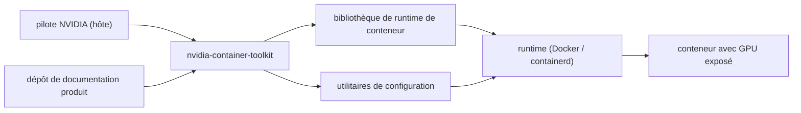

# NVIDIA/nvidia-container-toolkit

> Runtime library and utilities to build and run containers on NVIDIA GPUs.

## The problem
A container does not see the host's GPU: devices, driver libraries and variables must be exposed in the right place, which is not reproducible by hand.

## What it actually does
The README fits in three paragraphs. The toolkit makes it possible to build and run GPU-accelerated containers. It includes a container runtime library and utilities that automatically configure containers to use NVIDIA GPUs. The NVIDIA driver must be installed on the host; the CUDA Toolkit need not be — this is the only explicit technical point. Everything else (architecture overview, supported platforms, installation, usage, command-line options with Docker) is referred to the product documentation repository.

## How it is wired

## Trying it
No command documented in the README: it refers to the external installation guide and user guide.

## Cost and gotchas
Free. The prerequisite is the NVIDIA driver on the host, at the right version — and this is precisely where mismatches between host, toolkit and CUDA image occur. The README gives no compatibility matrix.

## What it is not
Not the CUDA Toolkit, explicitly: it does not need to be installed on the host. Not a scheduler nor GPU sharing: it exposes the card to the container, pooling is elsewhere. README under 800 useful characters: minimal sheet, nothing verifiable in the repository alone.

## Alternatives
No alternative named in the README.

## For you
Mandatory building block of any containerized training stack: install it without a second thought.
