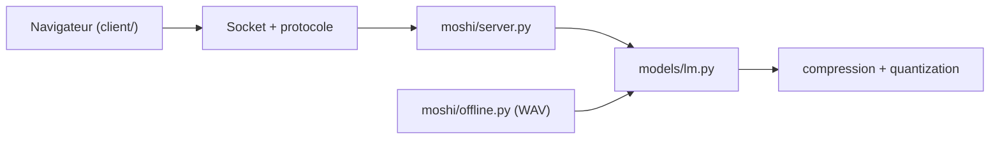

# NVIDIA/personaplex

> Real-time full-duplex voice model whose role and voice are controlled by text and audio prompts.

## The problem
Turn-based voice assistants are slow and unnatural, and their persona is hard to pin down.

## What it actually does
It adjusts the architecture and weights of Moshi (Helium LLM) on synthetic and real conversations (Fisher corpus). A Python server (`moshi.server`) streams audio with a React web interface; an offline script (`moshi.offline`) processes a WAV file. The persona comes from a role prompt and a voice embedding (NATF/NATM, VARF/VARM).

## How it is wired


## Trying it
```bash
pip install moshi/.
SSL_DIR=$(mktemp -d); python -m moshi.server --ssl "$SSL_DIR"
SSL_DIR=$(mktemp -d); python -m moshi.server --ssl "$SSL_DIR" --cpu-offload
```

## Cost and gotchas
GPU required (`--cpu-offload` option if memory is short), Opus library, Hugging Face token for the weights. Extra step for Blackwell GPUs. The last push dates from March 2026 and the weights license is not documented in the README.

## What it is not
Not a simple TTS or ASR: it is a speech-to-speech model. It is trained on a fixed assistant role and customer-service roles; the rest depends on generalization.

## Alternatives
No alternative named in the README (it cites Moshi as the base).

## For you
Worth watching: interesting for prototyping a low-latency voice agent, but it requires a GPU and the weights license remains to be checked before any use.
