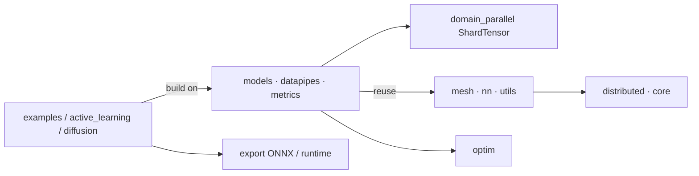

# NVIDIA/physicsnemo

> PyTorch framework for physics AI models, for SciML researchers and simulation engineers.

## The problem
Scientific representations (meshes, point clouds, grids, nested fields) do not fit into a standard PyTorch pipeline without losing their structure.
A high-resolution sample does not fit on a single GPU.

## What it actually does
Reusable components and end-to-end training recipes, as `torch.nn.Module` modules.
Model families: FNO/DPOT, MeshGraphNet/VFGN, Transolver/FLARE, GeoTransolver, DoMINO, FIGConvNet,
GLOBE and AeroJEPA (experimental); weather and climate AFNO, GraphCast, Pangu-Weather/FengWu, DLWP;
generative diffusion U-Net/DiT, TopoDiff.
`ShardTensor` splits a single sample across GPUs, alongside DDP and FSDP2.
Two NVIDIA skills for coding agents are included: PhysicsNeMo Discover and ShardTensor.

## How it is wired


## Trying it
```bash
pip install "nvidia-physicsnemo[cu13]"
pip install "nvidia-physicsnemo[cu12]"
pip install nvidia-physicsnemo
pip install "nvidia-physicsnemo[cu13,gnns]"
git clone https://github.com/NVIDIA/physicsnemo.git
uv sync --extra cu13
```

## Cost and gotchas
Free, but oriented toward NVIDIA GPUs: the default install picks the CUDA 13 backend and pulls in RAPIDS
packages. Modules under `physicsnemo.experimental` may change API between versions.
Python versions and exact constraints: read `pyproject.toml`.

## What it is not
It is not a solver or a replacement for numerical simulation: these are trained surrogates.
It is not a business application layer — that is explicitly delegated to PhysicsNeMo CFD,
PhysicsNeMo Curator, Earth2Studio and ALCHEMI. It is not independent of PyTorch.

## Alternatives
PhysicsNeMo Curator for scientific ETL, PhysicsNeMo CFD for inference and design,
Earth2Studio for weather and climate.

## For you
Relevant only if you do physics surrogates; otherwise, keep `ShardTensor` as an idea.
