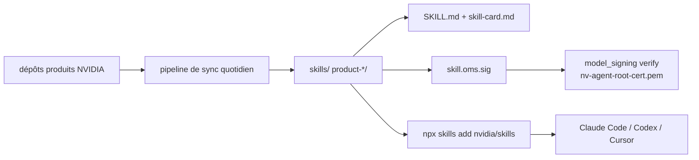

# NVIDIA/skills

> Catalog of NVIDIA-verified skills for coding agents, for those who use the NVIDIA software stack.

## The problem
A coding agent is unaware of recent NVIDIA APIs and invents cuOpt, DOCA or TAO calls.
Nothing guarantees that a skill found on the internet really comes from the vendor.

## What it actually does
A catalog repository: the skills are maintained in the product repositories and mirrored here every day
by a synchronization pipeline. Covers Physical AI and robotics, simulation, CUDA-X libraries,
RAG and blueprints, platform tools: cuDF, cuOpt, cuPyNumeric, DALI, DeepStream, DOCA, Dynamo,
Earth2Studio, Holoscan, Jetson, Megatron-Core, NeMo (AutoModel, MBridge, Relay, Retriever, RL),
Nemotron, NVFlare, PhysicsNeMo, TAO Toolkit, TileGym, VSS, Warp.
Each published skill carries `SKILL.md`, `skill-card.md`, a detached OMS signature, a Tier-3 evaluation
set and a `BENCHMARK.md`; the pipeline discards those missing an artifact.

## How it is wired


## Trying it
```bash
npx skills add nvidia/skills
npx skills add nvidia/skills --skill cuopt-numerical-optimization-api --agent claude-code --yes
npx skills update
npx skills add nvidia/skills --list
pip install model-signing
```

## Cost and gotchas
Free. Requires a `skills` CLI >= v1.5.16: on an older version, a skill may install
without appearing in Claude Code. Skills are renamed, merged or deleted upstream —
`npx skills update` also serves to clean up stale copies. The Physical AI skills are staged
manually, outside the automatic pipeline.

## What it is not
It is not the source code of the skills: it is a mirror, maintenance happens elsewhere.
It is not useful without NVIDIA hardware or a stack on the other end. The catalog is under open construction:
the README points to a roadmap for what is missing.

## Alternatives
None named; manual installation by copying folders is described as a fallback.

## For you
Keep it bookmarked: if you touch cuDF, TAO or NeMo, a signed skill beats a homemade prompt.
