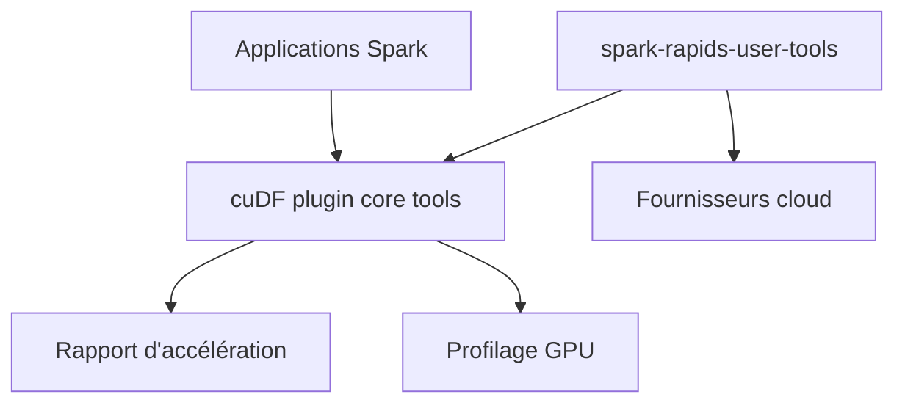

# NVIDIA/spark-rapids-tools

> NVIDIA tools to estimate the gain of a GPU plugin on existing Apache Spark applications.

## The problem
Knowing whether moving Spark to GPU is worth it requires measuring each application, without changing the code.

## What it actually does
The README is very short. It describes "core" tools that report the acceleration potential of the cuDF plugin on a set of Spark applications and produce a profiling analysis for GPU instances. A wrapper, spark-rapids-user-tools, runs them on several cloud providers and recommends settings based on the shape of the cluster.

## How it is wired
Simplified diagram based on the sheet, no diagram provided.

## Trying it
No command documented in the README provided.

## Cost and gotchas
Not documented: the README mentions neither installation nor prerequisites. Real use assumes Spark and GPU instances or a cloud, to be checked elsewhere.

## What it is not
It is not the Spark plugin itself, only the tools around it. The README says nothing about installation or the format of the reports.

## Alternatives
- No alternative named in the README.

## For you
Worth watching if you operate Spark clusters and are considering GPU: the tool measures the gain before you pay, but the README is too thin to conclude more.
