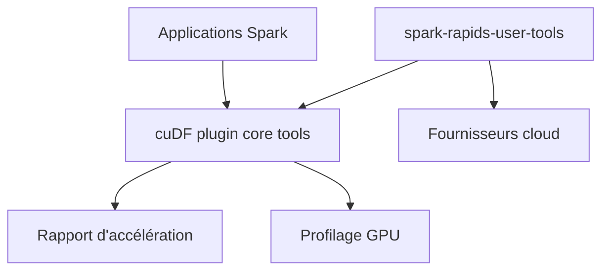

# NVIDIA/spark-rapids-tools

> Outils NVIDIA pour estimer le gain d'un plugin GPU sur des applications Apache Spark existantes.

## Le problème
Savoir si passer Spark sur GPU vaut le coup demande de mesurer chaque application, sans modifier le code.

## Ce que ça fait vraiment
Le README est très court. Il décrit des outils « core » qui rapportent le potentiel d'accélération du plugin cuDF sur un ensemble d'applications Spark et produisent une analyse de profilage pour les instances GPU. Un wrapper, spark-rapids-user-tools, les lance chez plusieurs fournisseurs cloud et recommande des réglages selon la forme du cluster.

## Comment c'est branché
Schéma simplifié d'après la fiche, sans diagramme fourni.

## Essayer
Aucune commande documentée dans le README fourni.

## Coût et pièges
Non documenté : le README ne parle ni d'installation ni de prérequis. L'usage réel suppose Spark et des instances GPU ou un cloud, à vérifier ailleurs.

## Ce que ce n'est pas
Ce n'est pas le plugin Spark lui-même, seulement les outils qui l'entourent. Le README ne dit rien de l'installation ni du format des rapports.

## Alternatives
- Aucune alternative nommée dans le README.

## Pour toi
À surveiller si tu opères des clusters Spark et envisages le GPU : l'outil mesure le gain avant de payer, mais le README est trop mince pour trancher plus.

