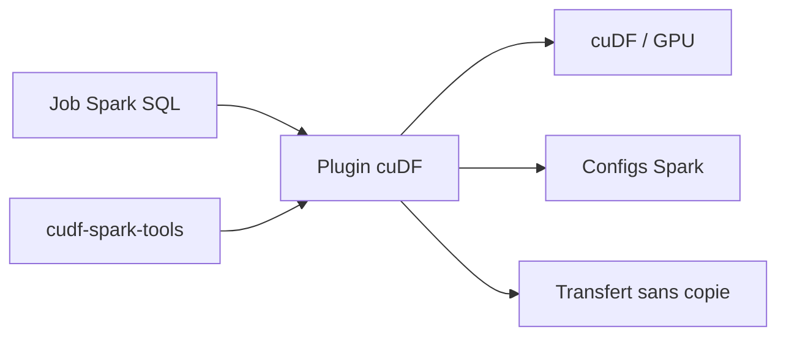

# NVIDIA/spark-rapids

> NVIDIA plugin that accelerates Apache Spark SQL and DataFrame queries on GPU via cuDF.

## The problem
Large Spark workloads are slow on CPU.

## What it actually does
Replaces Spark SQL operators with GPU versions (cuDF), aiming for bit-for-bit identical results with Spark. Configurable through Spark parameters, with a tuning guide, a zero-copy transfer API to other GPU applications (work in progress with XGBoost), and qualification and profiling tools in another repository. Formerly "RAPIDS Accelerator for Apache Spark".

## How it is wired


## Trying it
```xml
<dependency>
    <groupId>com.nvidia</groupId>
    <artifactId>rapids-4-spark_2.12</artifactId>
    <version>26.12.0-SNAPSHOT</version>
    <scope>provided</scope>
</dependency>
```

## Cost and gotchas
Requires NVIDIA GPUs. The RMM cache must be disabled to export to an ML library. 2,162 open issues; license not identified by GitHub.

## What it is not
Not a standalone engine: it is added on top of Spark. Some operators are not covered (see the compatibility notes).

## Alternatives
No alternative named in the README.

## For you
Adopt if your Spark pipelines already run on NVIDIA GPUs: a direct gain without rewriting jobs; otherwise of no interest.
