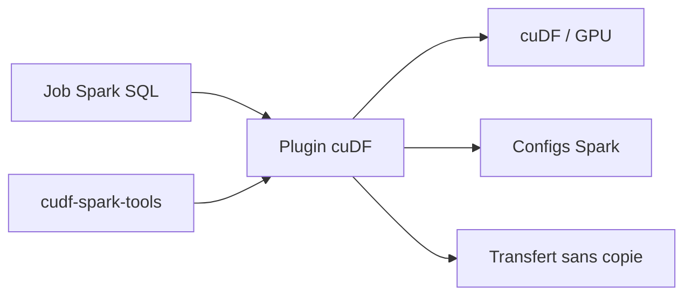

# NVIDIA/spark-rapids

> Plugin NVIDIA qui accélère les requêtes SQL et DataFrame d'Apache Spark sur GPU via cuDF.

## Le problème
Les traitements Spark volumineux sont lents sur CPU.

## Ce que ça fait vraiment
Remplace des opérateurs Spark SQL par des versions GPU (cuDF), avec résultats visant l'identité bit à bit avec Spark. Configurable par paramètres Spark, guide de réglage, API de transfert sans copie vers d'autres applications GPU (travail en cours avec XGBoost), outils de qualification et de profilage dans un autre dépôt. Anciennement « RAPIDS Accelerator for Apache Spark ».

## Comment c'est branché


## Essayer
```xml
<dependency>
    <groupId>com.nvidia</groupId>
    <artifactId>rapids-4-spark_2.12</artifactId>
    <version>26.12.0-SNAPSHOT</version>
    <scope>provided</scope>
</dependency>
```

## Coût et pièges
Exige des GPU NVIDIA. Cache RMM à désactiver pour exporter vers une bibliothèque ML. 2 162 issues ouvertes ; licence non identifiée par GitHub.

## Ce que ce n'est pas
Pas un moteur autonome : il s'ajoute à Spark. Certains opérateurs ne sont pas couverts (voir la compatibilité).

## Alternatives
Aucune alternative nommée dans le README.

## Pour toi
À adopter si tes pipelines Spark tournent déjà sur GPU NVIDIA : gain direct sans réécrire les jobs ; sinon sans intérêt.

