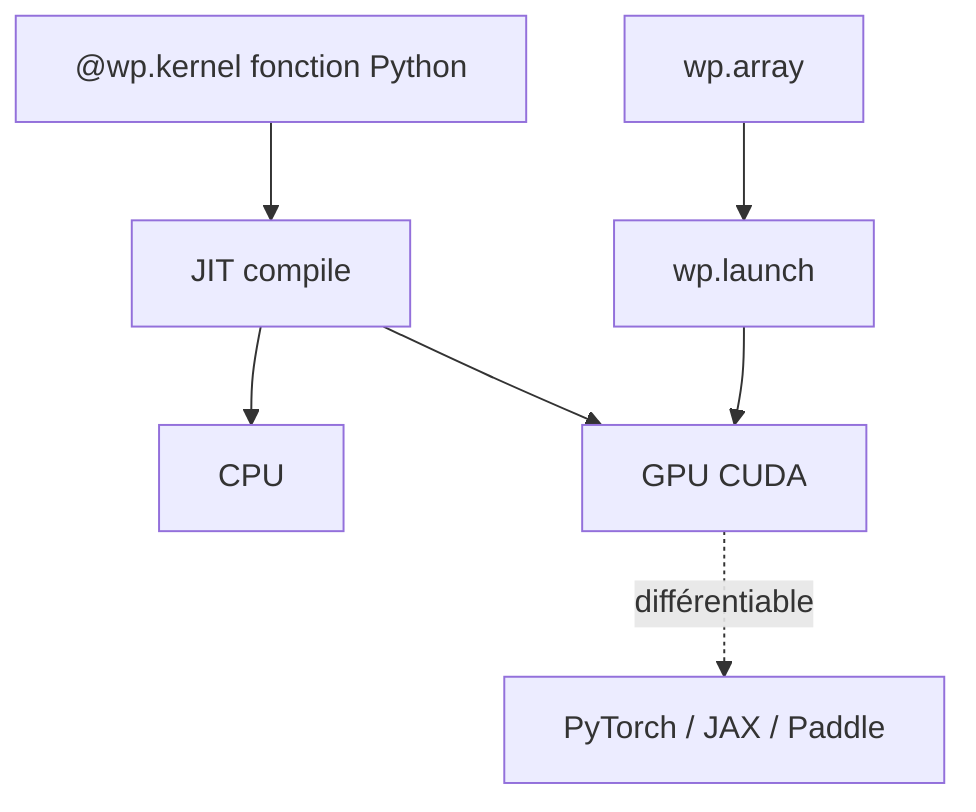

# NVIDIA/warp

> Python framework that JIT-compiles functions into CPU/GPU kernels for simulation and ML.

## The problem
Writing GPU-accelerated, differentiable physics simulations normally means going through CUDA or heavy frameworks. It is hard to stay in Python while keeping kernel-level performance.

## What it actually does
Decorate Python functions (`@wp.kernel`) and compile them into efficient kernel code that runs on CPU or GPU. Provides primitives for physics, robotics, geometry. Kernels are differentiable and plug into ML pipelines (PyTorch, JAX, Paddle). Rich set of examples: FEM, optimization, fluids, tile programming.

## How it is wired


## Trying it
```text
pip install warp-lang
```
```text
python -m warp.examples.browse
```

## Cost and gotchas
Free. An NVIDIA GPU and driver are required for CUDA acceleration; no Metal on macOS. libmathdx (statically linked) is governed by the NVIDIA Software License Agreement, which is separate.

## What it is not
Not a turnkey simulation engine: it is a low-level building block for writing your own kernels. No Metal support.

## Alternatives
Not documented in the README (it points to PyTorch/JAX as integration frameworks, not as substitutes).

## For you
Relevant if you do ML with differentiable simulation or GPU physics; otherwise too specialized.
