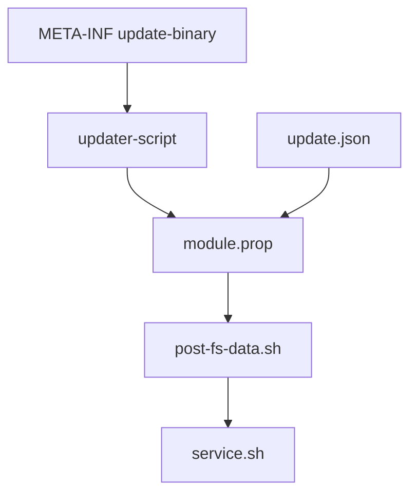

# NVISOsecurity/AlwaysTrustUserCerts

> Magisk module that places Android user certificates in the system store.

## The problem
Since Android 7, applications ignore certificates installed by the user, unless declared in their manifest.

## What it actually does
`post-fs-data.sh` and `service.sh` copy user certificates into the system store at boot, whether it is in `/system/etc/security/cacerts` or in the conscrypt path. Handles multiple users, Magisk, KernelSU. Advertised for Android 7 to 16.

## How it is wired

## Trying it
No command: install the certificate as a user certificate and reboot; to remove it, delete it in the settings and reboot.

## Cost and gotchas
Free. Requires a rooted Android with Magisk or KernelSU. License not declared. Last push in June 2025.

## What it is not
Not an interception tool in itself: it only changes certificate trust. Not usable without root.

## Alternatives
No alternative named in the README.

## For you
Ignore: used to inspect mobile traffic, with no link to data / AI / MLOps work.
