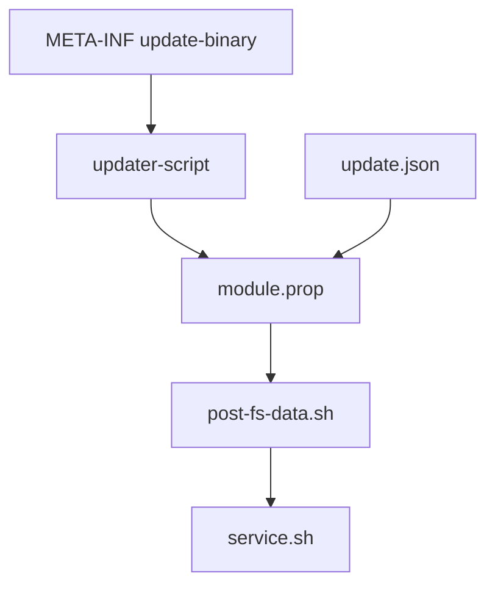

# NVISOsecurity/AlwaysTrustUserCerts

> Module Magisk qui place les certificats utilisateur Android dans le magasin système.

## Le problème
Depuis Android 7, les applications ignorent les certificats installés par l'utilisateur, sauf déclaration dans leur manifeste.

## Ce que ça fait vraiment
`post-fs-data.sh` et `service.sh` copient les certificats utilisateur dans le magasin système au démarrage, qu'il soit dans `/system/etc/security/cacerts` ou dans le chemin conscrypt. Gère plusieurs utilisateurs, Magisk, KernelSU. Annoncé pour Android 7 à 16.

## Comment c'est branché

## Essayer
Aucune commande : installer le certificat comme certificat utilisateur et redémarrer ; pour le retirer, le supprimer dans les réglages et redémarrer.

## Coût et pièges
Gratuit. Exige un Android rooté avec Magisk ou KernelSU. Licence non déclarée. Dernier push en juin 2025.

## Ce que ce n'est pas
Pas un outil d'interception en soi : il ne fait que changer la confiance en certificats. Pas utilisable sans root.

## Alternatives
Aucune alternative nommée dans le README.

## Pour toi
Ignorer : sert à inspecter du trafic mobile, sans lien avec un travail data / IA / MLOps.

