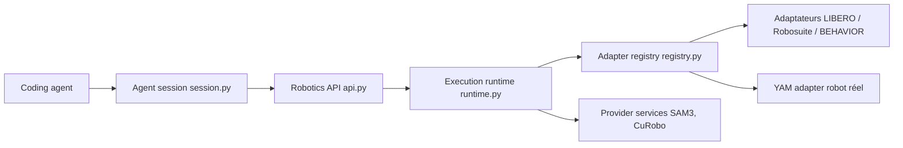

# NVlabs/ASPIRE

> Research framework where coding agents refine robotic skills, without gradient training.

## The problem
Teaching a robot new tasks requires costly training and opaque weights; here "learning" becomes a repository of readable skills.

## What it actually does
A coding agent (Claude Code or Codex) reads skills (`iterative-debugging`, `evosearch`), writes Python driving a robotics API, runs it in simulation (LIBERO-Pro, Robosuite, BEHAVIOR-1K) or on a YAM robot, evaluates, then corrects. Services provide perception (SAM3), grasp generation and planning (CuRobo). Results depend on the model used, according to the README.

## How it is wired


## Trying it
```bash
# Prompt à donner à Codex ou Claude Code (extrait du README) :
# "Clone the main branch of https://github.com/NVlabs/ASPIRE/, read the
#  iterative-debugging skill (.claude/skills/iterative-debugging/SKILL.md) and
#  docs/libero-pro.md, and run the complete ASPIRE LIBERO-Pro Goal-Swap Quick Start..."
# Préparer l'hôte d'abord : docs/host-setup.md (CUDA, uv, jeton Hugging Face pour SAM3)
```

## Cost and gotchas
Frontier model API calls at your expense, GPU, Hugging Face token for SAM3 weights under restricted access. The README warns: the LLM-generated code runs with all imports, with no sandbox.

## What it is not
Not a library to import nor a trained model. The real-robot recipes require a calibrated YAM station and operator authorization. Undocumented: the full cost of a run.

## Alternatives
No alternative named in the README.

## For you
Worth watching: an interesting approach for an AI/agents profile, but it involves executing generated code, a GPU and a YAM robot; only the simulation side is affordable.
