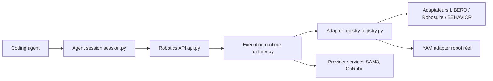

# NVlabs/ASPIRE

> Cadre de recherche où des agents de code affinent des compétences robotiques, sans entraînement par gradient.

## Le problème
Apprendre de nouvelles tâches à un robot demande de l'entraînement coûteux et des poids opaques ; ici l'« apprentissage » devient un dépôt de compétences lisibles.

## Ce que ça fait vraiment
Un agent de code (Claude Code ou Codex) lit des skills (`iterative-debugging`, `evosearch`), écrit du Python pilotant une API robotique, l'exécute en simulation (LIBERO-Pro, Robosuite, BEHAVIOR-1K) ou sur un robot YAM, évalue, puis corrige. Des services fournissent perception (SAM3), génération de prises et planification (CuRobo). Les résultats dépendent du modèle utilisé, selon le README.

## Comment c'est branché


## Essayer
```bash
# Prompt à donner à Codex ou Claude Code (extrait du README) :
# "Clone the main branch of https://github.com/NVlabs/ASPIRE/, read the
#  iterative-debugging skill (.claude/skills/iterative-debugging/SKILL.md) and
#  docs/libero-pro.md, and run the complete ASPIRE LIBERO-Pro Goal-Swap Quick Start..."
# Préparer l'hôte d'abord : docs/host-setup.md (CUDA, uv, jeton Hugging Face pour SAM3)
```

## Coût et pièges
Appels d'API de modèles de pointe à ta charge, GPU, jeton Hugging Face pour des poids SAM3 sous accès restreint. Le README avertit : le code généré par le LLM s'exécute avec tous les imports, sans sandbox.

## Ce que ce n'est pas
Pas une bibliothèque à importer ni un modèle entraîné. Les recettes de robot réel exigent une station YAM calibrée et une autorisation d'opérateur. Non documenté : coût complet d'un run.

## Alternatives
Aucune alternative nommée dans le README.

## Pour toi
À surveiller : approche intéressante pour un profil IA/agents, mais exécution de code généré, GPU et robot YAM ; seul le volet simulation est abordable.

