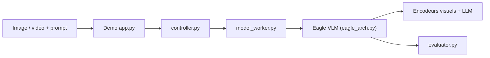

# NVlabs/Eagle

> NVIDIA family of data-centric vision-language models (Eagle, Eagle 2.5, LocateAnything).

## The problem
Understanding images and long videos, and locating objects, requires multimodal models trained with good data strategies.

## What it actually does
Publishes models: LocateAnything-3B (detection, pointing, grounding, parallel box decoding), Eagle 2.5 (long image and video understanding up to 128 K), Eagle 2 and Eagle (mixture of encoders). Demo code (controller, workers), training and evaluation code; weights on Hugging Face.

## How it is wired


## Trying it
```bash
# Aucune commande dans le README : renvois vers les guides
# « Getting started with LocateAnything / Eagle 2.5 ».
```

## Cost and gotchas
GPU required; weights to download from Hugging Face. Some code paths are inferred from the tree, not confirmed.

## What it is not
Not a ready-to-use service: a research repository. Model licenses depend on their bases (Qwen, Llama, Yi).

## Alternatives
- No alternative cited in the README.

## For you
Worth watching: a useful reference in open-source VLMs and detection, worth testing if you have a GPU; the examples do not replace an in-house benchmark.
