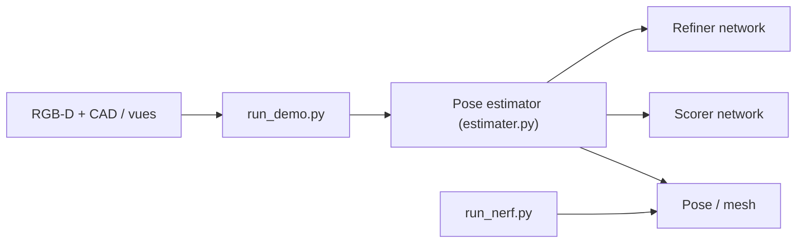

# NVlabs/FoundationPose

> Foundation model for estimating and tracking the 6D pose of unseen objects, for robotics and AR.

## The problem
Estimating the 6D pose of a new object without retraining usually requires one model per object.

## What it actually does
From RGB-D images, a camera and a CAD model (or a few reference views), it generates pose hypotheses, refines them and scores them with two networks (refiner, scorer), then switches to tracking. The model-free path learns a neural field (NeRF) and reconstructs a mesh.

## How it is wired


## Trying it
```bash
cd docker/
docker pull wenbowen123/foundationpose && docker tag wenbowen123/foundationpose foundationpose
bash docker/run_container.sh
bash build_all.sh
python run_demo.py
```

## Cost and gotchas
NVIDIA GPU, compiling PyTorch3D and NVDiffRast, weights and demo data to download. The diffusion-augmented data and their weights are not released: slight performance drop.

## What it is not
The license is not identified by GitHub: to be checked. The "#1 BOP" ranking dates from March 2024.

## Alternatives
- Isaac ROS Pose Estimation: ROS version with TensorRT inference, cited by the README.
- BundleSDF: model-free approach on which the few-shot path relies.

## For you
Worth watching: a reference in 6D perception if you do robotics; license to clarify and heavy installation.
