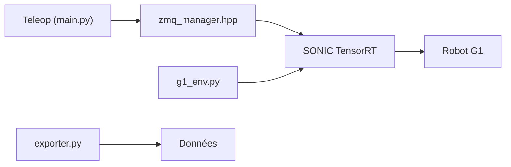

# NVlabs/GR00T-WholeBodyControl

> Whole-body controllers for humanoid robots (SONIC, MotionBricks, decoupled WBC), from training to deployment.

## The problem
Making a humanoid walk, crawl and be teleoperated with a single policy requires a complete pipeline.

## What it actually does
SONIC: unified motion-tracking policy, three checkpoints for Unitree G1 (default, low latency, v1.1), C++ deployment with TensorRT, training on Bones-SEED (142,000+ motions). Teleoperation via PICO headset, kinematic planner, MuJoCo simulation. MotionBricks: preview, real-time generative.

## How it is wired


## Trying it
```bash
python download_from_hf.py
cd gear_sonic_deploy
./deploy.sh --input-type zmq_manager real
pip install -e "gear_sonic/[training]"
```

## Cost and gotchas
Git LFS required. Isaac Lab installed separately; fine-tuning recommended with 64+ GPUs. MotionBricks checkpoints (~2.2 GiB) optional. Weights under the NVIDIA Open Model License; the repository license was not identified by GitHub.

## What it is not
Not usable without a robot or a simulator; the README asks you to test in simulation before the hardware.

## Alternatives
Beyond Mimic and Isaac Lab, cited as sources of the code.

## For you
A reference in learning-based robotics; too specialized and hardware-bound for everyday use: watch.
