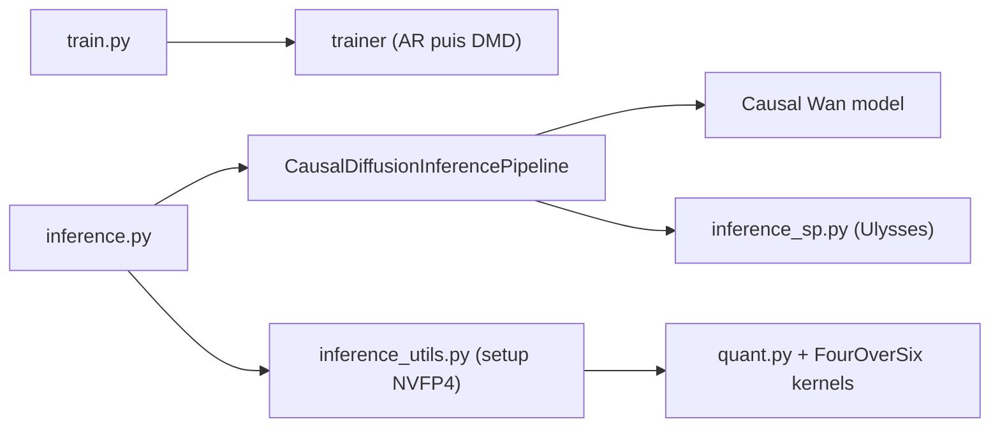

# NVlabs/LongLive

> NVIDIA infrastructure for training and running long video generation models, with NVFP4 quantization.

## The problem
Generating long videos in real time requires fast, memory-efficient autoregressive models, which are hard to train and serve.

## What it actually does
Three generations in one repository: LongLive-Plug, LongLive 1.0 (interactive generation, successive prompts, attention sink, KV-recache) and LongLive 2.0 (parallel, quantized training and inference). 2.0 offers NVFP4 inference (W4A4) with an NVFP4 KV cache, FP8 PTQ via TorchAO, multi-shot attention sink, sequence parallelism and asynchronous decoding. Two-stage training: AR teacher-forcing, then DMD distillation.

## How it is wired


## Trying it
```bash
git clone --single-branch --branch main --depth 1 https://github.com/NVlabs/LongLive.git
python inference.py --config_path configs/fp8/inference_fp8.yaml
torchrun --standalone --nnodes=1 --nproc_per_node=8 train.py --config_path configs/train_ar.yaml --logdir logs/train_ar --wandb-save-dir wandb --disable-wandb
```

## Cost and gotchas
Recent GPU: the validated stack is Python 3.10, PyTorch 2.8.0+cu128, TorchAO 0.13.0 on H100, compute capability 8.9 minimum for FP8. The `torch.compile` warm-up in `max-autotune` can last several minutes. A full clone brings in large resources.

## What it is not
Not a service or an application: a research repository. VBench scores come from the authors. Most of the variants cited (MemFlow, ShotStream...) are third-party projects.

## Alternatives
- MemFlow: adds adaptive memory for more coherent narratives.
- ShotStream: multi-shot streaming generation.
- SANA-Video (LongSANA): minute-long variant with constant-memory KV cache.

## For you
Worth watching: interesting for NVFP4 quantization and video distillation, but it requires recent NVIDIA hardware and remains research-oriented.
