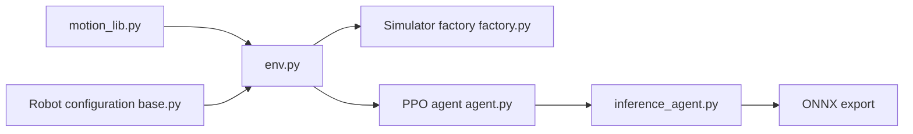

# NVlabs/ProtoMotions

> GPU-accelerated framework for training simulated humanoids and robots, aimed at RL and robotics researchers.

## The problem
Training physical characters and robots on large motion datasets requires linking simulator, data and RL, with no modular solution.

## What it actually does
Loads motions (AMASS, BONES-SEED, Kimodo), adapts them to a robot by PyRoki retargeting, trains policies (PPO, AMP, MaskedMimic) on Isaac Gym or Newton, tests in sim-to-sim (MuJoCo) and exports to ONNX for the Unitree G1 robot. Claims 12 hours on 4 A100s for AMASS. Environments are composed of separate parts (control, observation, reward).

## How it is wired


## Trying it
```bash
# Aucune commande exacte dans ce README :
# voir Installation Guide et Quick Start dans la documentation.
```

## Cost and gotchas
NVIDIA GPUs required, several A100s for the announced figures; Isaac Gym/IsaacSim simulators to install; AMASS data to obtain separately.

## What it is not
Not a turnkey tool: a research framework. The cited IsaacSim rendering is not physically interactive.

## Alternatives
MimicKit (a lighter sibling repo for motion imitation, cited in the README).

## For you
Worth watching: a serious reference if you do RL for robotics, but hardware and simulators block access otherwise.
