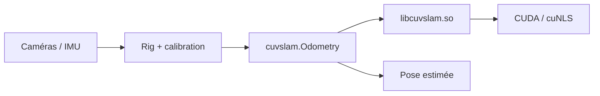

# NVlabs/PyCuVSLAM

> NVIDIA's CUDA-accelerated visual odometry and SLAM library, with Python bindings, for roboticists.

## The problem
Localizing a robot or a camera in real time from images (and an IMU) requires precise visual tracking, which is computationally expensive on embedded hardware.

## What it actually does
Provides five odometry modes (Mono, RGBD, Multicamera, Inertial, Multisensor) selected via `odometry_mode`. You must supply precise camera calibration and the rig configuration. The Multisensor mode is flagged as experimental, pinhole cameras only. Prebuilt wheels for desktop x86_64 and Jetson Orin/Thor.

## How it is wired


## Trying it
```bash
pip install cuvslam-*.whl
# depuis les sources
CUVSLAM_BUILD_DIR=<path-to-cuvslam-build> pip install python/
```

## Cost and gotchas
CUDA Toolkit 12 or 13 must be installed separately and match the wheel's `cu12`/`cu13` tag. Only a few Ubuntu/Python/Jetson combinations have a wheel.

## What it is not
Not a calibration-free SLAM: poor calibration or approximate synchronization degrades tracking. No wheel for CPU only. A license is present but not identified by GitHub.

## Alternatives
No alternative named in the README.

## For you
Worth watching: useful only if you do robotics or embedded vision on NVIDIA GPUs, and the license needs checking before any use.
