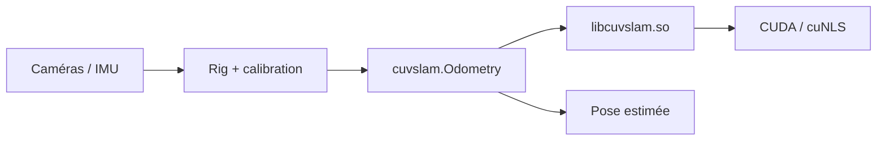

# NVlabs/PyCuVSLAM

> Bibliothèque NVIDIA d'odométrie visuelle et SLAM accélérée par CUDA, avec bindings Python, pour roboticiens.

## Le problème
Localiser un robot ou une caméra en temps réel à partir d'images (et d'une IMU) demande un tracking visuel précis, coûteux en calcul sur du matériel embarqué.

## Ce que ça fait vraiment
Fournit cinq modes d'odométrie (Mono, RGBD, Multicamera, Inertial, Multisensor) sélectionnés via `odometry_mode`. Il faut fournir une calibration précise des caméras et la config du rig. Le mode Multisensor est signalé expérimental, caméras pinhole uniquement. Wheels précompilées pour desktop x86_64 et Jetson Orin/Thor.

## Comment c'est branché


## Essayer
```bash
pip install cuvslam-*.whl
# depuis les sources
CUVSLAM_BUILD_DIR=<path-to-cuvslam-build> pip install python/
```

## Coût et pièges
Le CUDA Toolkit 12 ou 13 doit être installé à part et correspondre au tag `cu12`/`cu13` de la wheel. Seules quelques combinaisons Ubuntu/Python/Jetson ont une wheel.

## Ce que ce n'est pas
Pas un SLAM sans calibration : une mauvaise calibration ou une synchro approximative dégrade le tracking. Pas de wheel pour CPU seul. Licence présente mais non identifiée par GitHub.

## Alternatives
Aucune alternative nommée dans le README.

## Pour toi
À surveiller : utile seulement si tu fais de la robotique ou de la vision embarquée sur GPU NVIDIA, et la licence est à vérifier avant tout usage.

