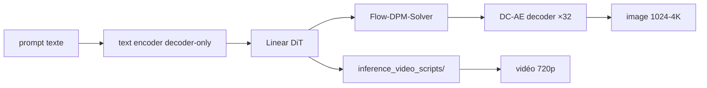

# NVlabs/Sana

> Family of efficient diffusion models for high-resolution images and video, training included.

## The problem
Generating 4K or video with a classic diffusion model requires server GPUs and tens of seconds per sample.

## What it actually does
Replaces the vanilla attention of the DiT with linear attention, and compresses images ×32 with DC-AE instead of ×8.
Bundles SANA, SANA-1.5, SANA-Sprint (0.1 s per 1024 px image on H100), SANA-Video, SANA-Video 2.0 (5B and 14B), SANA-WM, SANA-Streaming and Sol-RL.
Provides the full training and inference pipelines, plus ControlNet, LoRA/DreamBooth and 4/8-bit quantization.
Integrated into diffusers via `SanaPipeline`, and into ComfyUI and SGLang.

## How it is wired


## Trying it
```bash
git clone https://github.com/NVlabs/Sana.git
cd Sana && ./environment_setup.sh sana
bash inference_video_scripts/inference_sana_video.sh \
  --np 1 \
  --config configs/sana_video2/SanaVideo2_5B_720p.yaml \
  --step 50 --fps 24 --seed 4
```

## Cost and gotchas
GPU required; latency figures are measured on H100. The announced laptop deployment under 8 GB of VRAM goes through 4-bit quantization. Checkpoints are downloaded from Hugging Face, `diffusers>=0.32.0` required.

## What it is not
Not a finished product: it is a research codebase, with variants at different stages. The config and the 14B checkpoint of SANA-Video 2.0 are not yet included. The latency comparisons against Flux or Wan are the authors' own, on their protocol.

## Alternatives
FLUX-dev, Wan-2.1-14B and Wan-2.1-1.3B — the comparison points in the README's performance tables.

## For you
Worth watching if you generate images or video at controlled cost; the DC-AE ×32 trick is worth reading even without using it.
